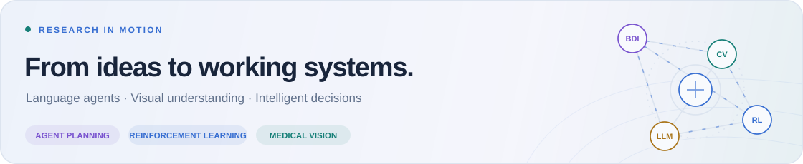
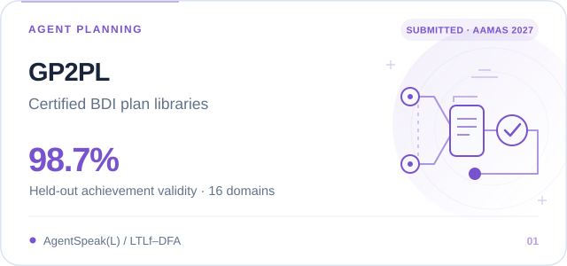
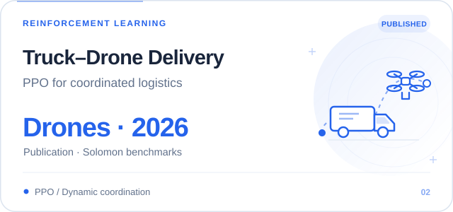
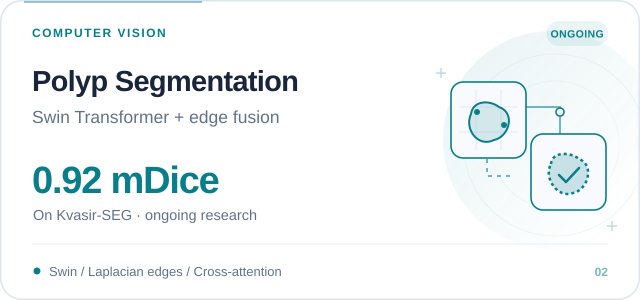
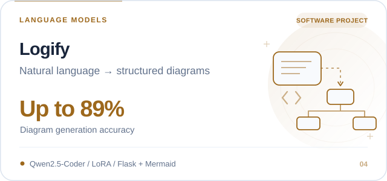
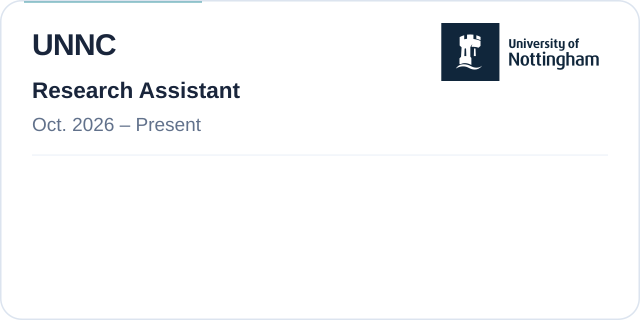
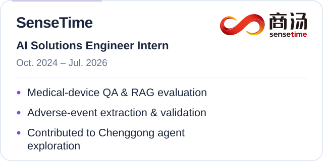
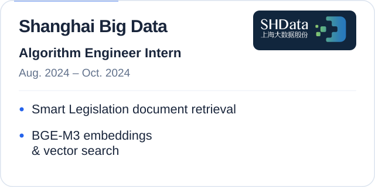
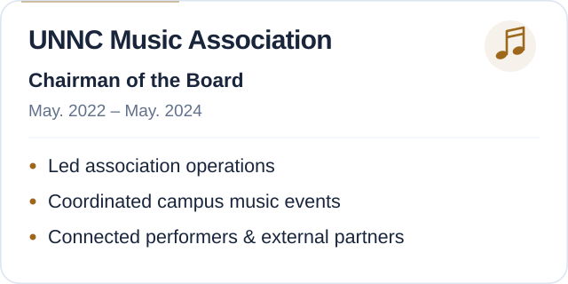

  <h1 align="center">Hi 👋, I'm Youyao Gao.</h1>

  <!-- profile logo 个人资料徽标 -->

  

    &emsp;
    &emsp;
    &emsp;
    &emsp;
    
  
 
  

  <picture>
    <source media="(prefers-color-scheme: dark)" srcset="./assets/profile/research-banner-dark.svg" />
    <source media="(prefers-color-scheme: light)" srcset="./assets/profile/research-banner-light.svg" />
    
  </picture>

<!-- ########################################## 分割 ########################################## -->

## Education

  <a href="https://www.cmu.edu/">
    <picture>
      <source media="(prefers-color-scheme: dark)" srcset="./assets/education/cmu-dark.svg" />
      <source media="(prefers-color-scheme: light)" srcset="./assets/education/cmu-light.svg" />
      
    </picture>
  </a>

  <a href="https://www.nottingham.ac.uk/">
    <picture>
      <source media="(prefers-color-scheme: dark)" srcset="./assets/education/nottingham-dark.svg" />
      <source media="(prefers-color-scheme: light)" srcset="./assets/education/nottingham-light.svg" />
      
    </picture>
  </a>

## Selected Projects

Four projects across planning, perception, and intelligent systems. Open a card to explore the code.

  <a href="https://github.com/daidaibunny/llm-bdi-pipeline">
    <picture>
      <source media="(prefers-color-scheme: dark)" srcset="./assets/cards/gp2pl-dark.svg" />
      <source media="(prefers-color-scheme: light)" srcset="./assets/cards/gp2pl-light.svg" />
      
    </picture>
  </a>
  <a href="https://github.com/dashen2004/Reinforcement-Learing-Baesd-HybridTruck-Drone-Delivery-Optimization">
    <picture>
      <source media="(prefers-color-scheme: dark)" srcset="./assets/cards/truck-drone-dark.svg" />
      <source media="(prefers-color-scheme: light)" srcset="./assets/cards/truck-drone-light.svg" />
      
    </picture>
  </a>
  <a href="https://github.com/dashen2004/Edge-Enhanced-Dual-Stream-Transformer-for-Small-Polyp-Segmentation">
    <picture>
      <source media="(prefers-color-scheme: dark)" srcset="./assets/cards/polyp-dark.svg" />
      <source media="(prefers-color-scheme: light)" srcset="./assets/cards/polyp-light.svg" />
      
    </picture>
  </a>
  <a href="https://github.com/dashen2004/Logify">
    <picture>
      <source media="(prefers-color-scheme: dark)" srcset="./assets/cards/logify-dark.svg" />
      <source media="(prefers-color-scheme: light)" srcset="./assets/cards/logify-light.svg" />
      
    </picture>
  </a>

<a href="https://doi.org/10.3390/drones10070477">📄 Drones paper</a> &nbsp;·&nbsp; <a href="mailto:youyaog@andrew.cmu.edu">Get in touch</a>

## Work Experience

  <a href="https://www.nottingham.edu.cn/en/index.aspx">
    <picture>
      <source media="(prefers-color-scheme: dark)" srcset="./assets/experience/unnc-ra-dark.svg" />
      <source media="(prefers-color-scheme: light)" srcset="./assets/experience/unnc-ra-light.svg" />
      
    </picture>
  </a>
  <a href="https://www.sensetime.com/cn">
    <picture>
      <source media="(prefers-color-scheme: dark)" srcset="./assets/experience/sensetime-dark.svg" />
      <source media="(prefers-color-scheme: light)" srcset="./assets/experience/sensetime-light.svg" />
      
    </picture>
  </a>
  <a href="https://www.shdata.com/">
    <picture>
      <source media="(prefers-color-scheme: dark)" srcset="./assets/experience/shdata-dark.svg" />
      <source media="(prefers-color-scheme: light)" srcset="./assets/experience/shdata-light.svg" />
      
    </picture>
  </a>
    <picture>
      <source media="(prefers-color-scheme: dark)" srcset="./assets/experience/music-dark.svg" />
      <source media="(prefers-color-scheme: light)" srcset="./assets/experience/music-light.svg" />
      
    </picture>

## Honors & Activities

- **Successful Participant**, Mathematical Contest in Modeling (MCM) | **2025**.
- **Meritorious Award**, Shuwei Cup International Mathematical Contest in Modeling | **2024**.
- **Student Representative**, Learning Community Forum (LCF), UNNC | **2024 – 2025**: Represented student perspectives and provided feedback on education and student experience initiatives.

<!-- ########################################## 分割 ########################################## -->

## Technical Toolkit

Tools I build with, and technologies I explore.

  
<!-- gif -->

<!-- svg -->

<!-- programming tool icon 编程工具图标 -->
 

<!-- CV toolkit additions:start -->

<strong>Frameworks &amp; Tools</strong>

  
  
  
  

<strong>AI Methods &amp; Agent Planning</strong>

  
  
  
  
  

<!-- CV toolkit additions:end -->

<b>Skills &amp; languages</b>

- **Programming Languages:** Python, SQL, C/C++, Java.
- **AI and Machine Learning:** PyTorch, TensorFlow, scikit-learn, RAG, PPO, LoRA.
- **Frameworks and Tools:** Pandas, Flask, Django, Docker, Git, Linux, MySQL, MMSegmentation, LaTeX.
- **Languages:** Mandarin Chinese (Native), Shanghainese (Native), English (Fluent; TOEFL 104).

<!-- ########################################## 分割 ########################################## -->

## GitHub Activity

  <picture>
    <source media="(prefers-color-scheme: dark)" srcset="https://github-readme-stats.vercel.app/api/top-langs?username=dashen2004&amp;show_icons=true&amp;locale=en&amp;layout=compact&amp;theme=github_dark" />
    <source media="(prefers-color-scheme: light)" srcset="https://github-readme-stats.vercel.app/api/top-langs?username=dashen2004&amp;show_icons=true&amp;locale=en&amp;layout=compact" />
    
  </picture>
  <picture>
    <source media="(prefers-color-scheme: dark)" srcset="https://github-readme-stats.vercel.app/api?username=dashen2004&amp;show_icons=true&amp;locale=en&amp;theme=github_dark" />
    <source media="(prefers-color-scheme: light)" srcset="https://github-readme-stats.vercel.app/api?username=dashen2004&amp;show_icons=true&amp;locale=en" />
    
  </picture>

<!-- github-readme-streak-stats 连续提交代码天数记录 -->

  
  <picture>
    <source media="(prefers-color-scheme: dark)" srcset="https://github-readme-streak-stats.herokuapp.com/?user=dashen2004&amp;theme=dark&amp;hide_border=true" />
    <source media="(prefers-color-scheme: light)" srcset="https://github-readme-streak-stats.herokuapp.com/?user=dashen2004&amp;theme=light&amp;hide_border=true" />
    
  </picture>
  

<!-- GitHub Activity Graph GitHub 活动图 -->

  <picture>
    <source media="(prefers-color-scheme: dark)" srcset="https://github-profile-summary-cards.vercel.app/api/cards/profile-details?username=dashen2004&amp;theme=github_dark&amp;animation=draw&amp;duration=3&amp;name=Youyao%20Gao&amp;title_color=58a6ff&amp;text_color=c9d1d9&amp;chart_color=3fb950&amp;bg_color=0d1117&amp;border_color=30363d" />
    <source media="(prefers-color-scheme: light)" srcset="https://github-profile-summary-cards.vercel.app/api/cards/profile-details?username=dashen2004&amp;theme=github&amp;animation=draw&amp;duration=3&amp;name=Youyao%20Gao" />
    
  </picture>

### A Year in Motion

  <picture>
    <source media="(prefers-color-scheme: dark)" srcset="https://raw.githubusercontent.com/dashen2004/dashen2004/output/github-snake-dark.svg" />
    <source media="(prefers-color-scheme: light)" srcset="https://raw.githubusercontent.com/dashen2004/dashen2004/output/github-snake.svg" />
    
  </picture>

<!-- just img 图片 -->

  

<!-- ########################################## 分割 ########################################## -->

<a href="mailto:youyaog@andrew.cmu.edu">Let’s talk research &amp; ideas</a> &nbsp;·&nbsp; <a href="#hi--im-youyao-gao">Back to top ↑</a>

